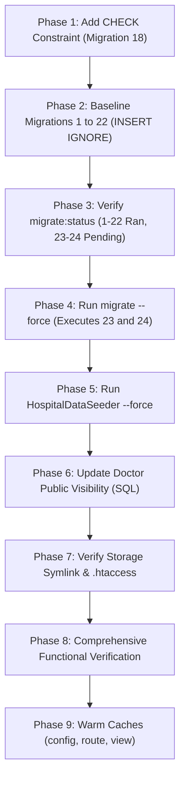

# MediCare HMS — Production Database Repair & Reconciliation Runbook

**Document Reference:** `docs/production-repair-runbook.md`  
**Application:** MediCare Hospital Management System (`medicare-hms`)  
**Target Production Environment:** Truehost cPanel (CloudLinux / CentOS)  
**Production Database Engine:** MySQL 8.0.41 (Confirmed via mysqldump header)  
**Production Database Name:** `xqtrqexj_medicare`  
**Production URL:** `https://medicare.kennedycheroben.co.ke`  
**Application Root Directory:** `/home/xqtrqexj/medicare-hms-app`  
**Web Document Root:** `/home/xqtrqexj/medicare.kennedycheroben.co.ke`  
**Author:** Senior Laravel Engineer  
**Date:** October 28, 2026  
**Status:** Pre-Approved for Maintenance Window Execution (No Production Changes Made Yet)

---

## 1. Safety Invariants & Operational Rules

Before executing any commands on the live server, the maintenance operator MUST strictly adhere to the following invariants:

1. **NEVER run `migrate:fresh`, `migrate:reset`, or `migrate:rollback` (without `--step=N`)**:
   These commands drop database tables and will permanently destroy the 11 real staff accounts, 2 published news articles, 36 audit logs, and live patient contact inquiries.
2. **NEVER drop or truncate existing populated tables**:
   Tables `users`, `articles`, `audit_logs`, `contact_inquiries`, `patient_accounts`, and `patients` must remain strictly untouched.
3. **NEVER blindly insert 24 migration records**:
   Doing so would falsely mark Migrations 23 (`doctors.status`) and 24 (`notifications`) as executed when their physical columns and tables do not exist, leading to runtime HTTP 500 crashes during doctor filtering and appointment booking.
4. **NEVER overwrite the web root `.htaccess`**:
   The `.htaccess` file in `/home/xqtrqexj/medicare.kennedycheroben.co.ke/` contains the cPanel MultiPHP / CloudLinux handler binding the application to PHP 8.4. Replacing it with default repository `.htaccess` will reset PHP to system default and cause fatal syntax errors.
5. **DO NOT execute `StaffUserSeeder`**:
   Demonstration staff accounts must never be seeded into production. Execute ONLY `HospitalDataSeeder` (`--class=HospitalDataSeeder`).
6. **DO NOT execute optimization caching (`config:cache`, `route:cache`, `view:cache`) early**:
   Cache warming must occur ONLY at the very end of the maintenance window after all migrations, seeders, and functional web checks have succeeded.

---

## 2. Pre-Flight Gate Checks (Read-Only)

Execute these read-only SQL queries and CLI checks before making any changes. If any check fails its required gate condition, **ABORT IMMEDIATELY**.

### Check 2.1: Verify Preserved Data Counts
In cPanel phpMyAdmin or MySQL CLI:
```sql
USE xqtrqexj_medicare;

SELECT 
    (SELECT count(*) FROM users) AS live_users_count,
    (SELECT count(*) FROM articles) AS live_articles_count,
    (SELECT count(*) FROM audit_logs) AS live_audit_logs_count,
    (SELECT count(*) FROM contact_inquiries) AS live_inquiries_count,
    (SELECT count(*) FROM departments) AS departments_count,
    (SELECT count(*) FROM doctors) AS doctors_count,
    (SELECT count(*) FROM migrations) AS migrations_count;
```

**Required Gate Result:**
- `live_users_count`: **11**
- `live_articles_count`: **2**
- `live_audit_logs_count`: **>= 36**
- `live_inquiries_count`: **>= 1**
- `departments_count`: **0**
- `doctors_count`: **0**
- `migrations_count`: **0**

> [!CAUTION]
> **STOP CONDITION:** If `live_users_count` is not 11 or `live_articles_count` is not 2, do NOT proceed. Stop and investigate the live database immediately.

---

### Check 2.2: Verify Missing Schema Artefacts
Confirm that the live database matches the audit findings:
```sql
USE xqtrqexj_medicare;

-- 1. Verify doctors.status is missing
SELECT count(*) AS status_exists 
FROM information_schema.COLUMNS 
WHERE TABLE_SCHEMA = 'xqtrqexj_medicare' AND TABLE_NAME = 'doctors' AND COLUMN_NAME = 'status';
-- Expected Gate Result: 0

-- 2. Verify notifications table is missing
SELECT count(*) AS notifications_exists 
FROM information_schema.TABLES 
WHERE TABLE_SCHEMA = 'xqtrqexj_medicare' AND TABLE_NAME = 'notifications';
-- Expected Gate Result: 0

-- 3. Verify medicine_batches_qty_nonneg check constraint is missing
SELECT count(*) AS check_constraint_exists 
FROM information_schema.TABLE_CONSTRAINTS 
WHERE TABLE_SCHEMA = 'xqtrqexj_medicare' 
  AND TABLE_NAME = 'medicine_batches' 
  AND CONSTRAINT_NAME = 'medicine_batches_qty_nonneg';
-- Expected Gate Result: 0
```

> [!CAUTION]
> **STOP CONDITION:** If `status_exists` > 0 or `notifications_exists` > 0, an undocumented schema change has already occurred. Stop and inspect the table structures manually before running migrations.

---

### Check 2.3: Verify Baseline Tables from Migrations 1 Through 22
Verify that all 26 tables corresponding to Migrations 1–22 physically exist before any migration rows are inserted:
```sql
USE xqtrqexj_medicare;

SELECT count(*) AS baseline_table_count
FROM information_schema.TABLES
WHERE TABLE_SCHEMA = 'xqtrqexj_medicare'
  AND TABLE_NAME IN (
    'users', 'password_reset_tokens', 'sessions', 'cache', 'cache_locks',
    'jobs', 'job_batches', 'failed_jobs', 'departments', 'doctors',
    'appointments', 'contact_inquiries', 'audit_logs', 'patients',
    'visits', 'triage_records', 'consultations', 'medicines',
    'medicine_batches', 'stock_transactions', 'prescriptions',
    'prescription_items', 'dispensings', 'dispensing_items',
    'doctor_reviews', 'articles', 'patient_accounts'
  );
```
**Required Gate Result:** `baseline_table_count` = **27** (all base tables and auxiliary session/cache tables exist).

> [!IMPORTANT]
> **Why `INSERT IGNORE` is Safe ONLY After Schema Verification:**
> `INSERT IGNORE` marks migrations as "Ran" in the Laravel internal tracking table. If any column, index, or table from Migrations 1–22 were physically missing and marked as ran, Laravel would permanently skip running the migration in the future, leaving the database broken. Running Check 2.3 guarantees that every single table and column is physically present in the database before recording history rows.

---

### Check 2.4: cPanel Database User Verification & Validated Backup
In cPanel environments, the database username does not always equal the database name (it may use truncated prefixes or custom user accounts). 

#### Step 2.4.1: Identify the Database Username Safely (Zero Password Exposure)
- **Method A (cPanel GUI):** Go to cPanel -> **MySQL Databases** -> Scroll to **Current Databases** -> Locate `xqtrqexj_medicare` -> Read the username in the **Privileged Users** column.
- **Method B (Terminal):** Safely extract only the username key from `.env`:
  ```bash
  grep '^DB_USERNAME=' /home/xqtrqexj/medicare-hms-app/.env | cut -d '=' -f2 | tr -d ' "\r'
  ```

#### Step 2.4.2: Execute Timestamped Secondary Backup with Integrity Gate
Run in the cPanel Terminal:
```bash
# Set verified username
DB_USER=$(grep '^DB_USERNAME=' /home/xqtrqexj/medicare-hms-app/.env | cut -d '=' -f2 | tr -d ' "\r')
BACKUP_FILE="/home/xqtrqexj/backup_before_repair_$(date +%Y%m%d_%H%M%S).sql"

# Execute dump (prompt will ask for password securely)
mysqldump -u "$DB_USER" -p xqtrqexj_medicare > "$BACKUP_FILE"

# Validate backup exit code, non-empty size (>50KB), and SQL footer completeness
if [ $? -eq 0 ] && [ -s "$BACKUP_FILE" ] && tail -n 10 "$BACKUP_FILE" | grep -q 'Dump completed'; then
    echo "SUCCESS: Backup verified at $BACKUP_FILE (Size: $(du -h "$BACKUP_FILE" | cut -f1))"
else
    echo "FATAL: Backup creation failed or dump is truncated! ABORTING ALL CHANGES."
    exit 1
fi
```

> [!CAUTION]
> **STOP CONDITION:** If the backup command exit code is non-zero, the file is empty, or the dump footer is missing, **ABORT IMMEDIATELY**.
> Note: The independent cold backup at `/home/cheroben/Downloads/xqtrqexj_medicare.sql` is strictly preserved and untouched.

---

## 3. Step-by-Step Execution Sequence

Every step below defines a **Precondition**, **Execution Command / SQL**, **Expected Result**, and **Stop Condition**.



---

### Phase 1: Reconcile Missing CHECK Constraint (Migration 18)

- **Precondition:** `information_schema.TABLE_CONSTRAINTS` confirms `medicine_batches_qty_nonneg` does not exist on table `medicine_batches`.
- **Execution SQL:**
  ```sql
  USE xqtrqexj_medicare;

  ALTER TABLE medicine_batches 
  ADD CONSTRAINT medicine_batches_qty_nonneg CHECK (quantity_current >= 0);
  ```
- **Expected Result:** `Query OK, 0 rows affected`.
- **Verification Query (MySQL 8.0.41):**
  ```sql
  SELECT CONSTRAINT_NAME, ENFORCED
  FROM information_schema.CHECK_CONSTRAINTS
  JOIN information_schema.TABLE_CONSTRAINTS USING (CONSTRAINT_SCHEMA, CONSTRAINT_NAME)
  WHERE CONSTRAINT_SCHEMA = 'xqtrqexj_medicare'
    AND TABLE_NAME = 'medicine_batches'
    AND CONSTRAINT_NAME = 'medicine_batches_qty_nonneg';
  ```
  *Expected Output:* `medicine_batches_qty_nonneg` | `YES`.
- **Stop Condition:** If the query returns an error or `ENFORCED` is not `YES`, abort maintenance.

---

### Phase 2: Baseline Migrations 1 Through 22 (Resume-Safe & Idempotent)

- **Precondition:** All tables from Check 2.3 exist; Phase 1 check constraint is applied; current `migrations` table has 0 rows (or partial rows if resuming).
- **Execution SQL:**
  ```sql
  USE xqtrqexj_medicare;

  INSERT IGNORE INTO `migrations` (`migration`, `batch`) VALUES
  ('0001_01_01_000000_create_users_table', 1),
  ('0001_01_01_000001_create_cache_table', 1),
  ('0001_01_01_000002_create_jobs_table', 1),
  ('2026_10_20_000634_create_departments_table', 1),
  ('2026_10_20_000635_create_doctors_table', 1),
  ('2026_10_20_000636_create_appointments_table', 1),
  ('2026_10_20_000637_create_contact_inquiries_table', 1),
  ('2026_10_21_010001_add_role_and_status_to_users_table', 1),
  ('2026_10_21_010002_create_audit_logs_table', 1),
  ('2026_10_21_020001_create_patients_table', 1),
  ('2026_10_21_020002_add_patient_id_to_appointments_table', 1),
  ('2026_10_21_020003_create_visits_table', 1),
  ('2026_10_21_020004_create_triage_records_table', 1),
  ('2026_10_21_030001_create_consultations_table', 1),
  ('2026_10_21_030002_create_medicines_and_inventory_tables', 1),
  ('2026_10_21_030003_create_prescriptions_table', 1),
  ('2026_10_21_030004_create_dispensings_table', 1),
  ('2026_10_21_030005_phase6_refinements', 1),
  ('2026_10_22_000001_enhance_appointments_for_staff_management', 1),
  ('2026_10_22_000002_add_publication_and_reviews_to_doctors', 1),
  ('2026_10_22_000003_create_articles_table', 1),
  ('2026_10_22_000004_create_patient_accounts_table', 1);
  ```
- **Expected Result:** `Query OK, 22 rows affected` (or fewer if resuming).
- **Verification Query:**
  ```sql
  SELECT count(*) AS baselined_count FROM migrations WHERE batch = 1;
  ```
  *Expected Output:* `22`.
- **Stop Condition:** If `baselined_count` != 22, abort. Do not run `migrate`.

---

### Phase 3: Verify Artisan Migration Status

- **Precondition:** Phase 2 verified with exactly 22 rows in `batch = 1`.
- **Execution Command (Terminal in `/home/xqtrqexj/medicare-hms-app`):**
  ```bash
  cd /home/xqtrqexj/medicare-hms-app
  php artisan migrate:status
  ```
- **Expected Output:**
  ```
   Migration name .................................................... Batch / Status 
   0001_01_01_000000_create_users_table .................................... [1] Ran 
   0001_01_01_000001_create_cache_table .................................... [1] Ran 
   0001_01_01_000002_create_jobs_table ..................................... [1] Ran 
   2026_10_20_000634_create_departments_table .............................. [1] Ran 
   2026_10_20_000635_create_doctors_table .................................. [1] Ran 
   2026_10_20_000636_create_appointments_table ............................. [1] Ran 
   2026_10_20_000637_create_contact_inquiries_table ........................ [1] Ran 
   2026_10_21_010001_add_role_and_status_to_users_table .................... [1] Ran 
   2026_10_21_010002_create_audit_logs_table ............................... [1] Ran 
   2026_10_21_020001_create_patients_table ................................. [1] Ran 
   2026_10_21_020002_add_patient_id_to_appointments_table ................. [1] Ran 
   2026_10_21_020003_create_visits_table ................................... [1] Ran 
   2026_10_21_020004_create_triage_records_table ........................... [1] Ran 
   2026_10_21_030001_create_consultations_table ............................ [1] Ran 
   2026_10_21_030002_create_medicines_and_inventory_tables ................. [1] Ran 
   2026_10_21_030003_create_prescriptions_table ............................ [1] Ran 
   2026_10_21_030004_create_dispensings_table .............................. [1] Ran 
   2026_10_21_030005_phase6_refinements .................................... [1] Ran 
   2026_10_22_000001_enhance_appointments_for_staff_management ............ [1] Ran 
   2026_10_22_000002_add_publication_and_reviews_to_doctors ................ [1] Ran 
   2026_10_22_000003_create_articles_table ................................. [1] Ran 
   2026_10_22_000004_create_patient_accounts_table ......................... [1] Ran 
   2026_10_27_234320_add_status_to_doctors_table .......................... Pending 
   2026_10_27_235338_create_notifications_table ............................ Pending 
  ```
- **Stop Condition:** If any migration other than `add_status_to_doctors_table` and `create_notifications_table` is marked as `Pending`, **DO NOT RUN MIGRATE**. Stop and inspect.

---

### Phase 4: Execute Pending Migrations 23 and 24

- **Precondition:** Only Migrations 23 and 24 are `Pending`.
- **Execution Command:**
  ```bash
  php artisan migrate --force
  ```
- **Expected Output:**
  ```
   INFO  Running migrations.  

   2026_10_27_234320_add_status_to_doctors_table .......................... DONE
   2026_10_27_235338_create_notifications_table ............................ DONE
  ```
- **Verification Query:**
  ```sql
  SELECT count(*) AS total_migrations FROM migrations;
  ```
  *Expected Output:* `24`.
- **Stop Condition:** If the command exits with an error code, execute `php artisan migrate:rollback --step=2` and restore from pre-maintenance backup.

---

### Phase 5: Populate Departments and Doctors

- **Precondition:** Migrations 23 and 24 succeeded; `departments` and `doctors` have 0 rows; `users` has 11 rows.
- **Execution Command:**
  ```bash
  php artisan db:seed --class=HospitalDataSeeder --force
  ```
- **Expected Output:**
  ```
   INFO  Seeding database.  

   Database\Seeders\HospitalDataSeeder .................................... DONE
  ```
- **Verification Queries:**
  ```sql
  SELECT 
      (SELECT count(*) FROM departments) AS departments_count,
      (SELECT count(*) FROM doctors) AS doctors_count,
      (SELECT count(*) FROM users) AS users_count;
  ```
  *Expected Output:* `departments_count` = 6, `doctors_count` = 6, `users_count` = 11.
- **Stop Condition:** If `users_count` is not 11, or `departments_count` != 6, or `doctors_count` != 6, abort immediately.

---

### Phase 6: Explicitly Enforce Doctor Public Visibility

- **Precondition:** 6 doctors seeded in `doctors` table.
- **Execution SQL:**
  ```sql
  USE xqtrqexj_medicare;

  UPDATE doctors 
  SET status = 'approved', 
      is_published = 1, 
      is_available = 1, 
      published_at = COALESCE(published_at, NOW()) 
  WHERE status IS NULL OR status = 'approved';
  ```
- **Verification Query:**
  ```sql
  SELECT count(*) AS visible_doctors 
  FROM doctors 
  WHERE is_published = 1 AND is_available = 1 AND status = 'approved';
  ```
  *Expected Output:* `6`.
- **Stop Condition:** If `visible_doctors` != 6, check `SELECT id, name, status, is_published, is_available FROM doctors;`.

---

### Phase 7: Storage Symlink & cPanel PHP Handler Preservation

- **Precondition:** Terminal access to `/home/xqtrqexj`.
- **Execution Commands:**
  ```bash
  # 1. Safely check and create public storage symlink without touching existing directories or files
  if [ ! -e /home/xqtrqexj/medicare.kennedycheroben.co.ke/storage ]; then
      ln -s /home/xqtrqexj/medicare-hms-app/storage/app/public /home/xqtrqexj/medicare.kennedycheroben.co.ke/storage
      echo "Storage symlink created."
  else
      echo "Storage symlink already exists. Left unmodified."
  fi

  # 2. Verify symlink points to correct app storage directory
  ls -l /home/xqtrqexj/medicare.kennedycheroben.co.ke/storage

  # 3. Verify .htaccess in web root is intact and has PHP 8.4 handler
  head -n 25 /home/xqtrqexj/medicare.kennedycheroben.co.ke/.htaccess
  ```
- **Expected Result:** Symlink points to `/home/xqtrqexj/medicare-hms-app/storage/app/public`. `.htaccess` contains the CloudLinux/MultiPHP handler.
- **Stop Condition:** If `.htaccess` was accidentally replaced or storage points to wrong target, restore `.htaccess` from backup.

---

## 4. Post-Repair Functional Verification Checklist

Execute these verifications BEFORE running any cache-warming optimization commands.

### Verification 4.1: Database Sanity (SQL)
```sql
USE xqtrqexj_medicare;

SELECT 
    (SELECT count(*) FROM users) AS users_count,
    (SELECT count(*) FROM articles) AS articles_count,
    (SELECT count(*) FROM audit_logs) AS audit_logs_count,
    (SELECT count(*) FROM contact_inquiries) AS inquiries_count,
    (SELECT count(*) FROM departments) AS departments_count,
    (SELECT count(*) FROM doctors) AS doctors_count,
    (SELECT count(*) FROM notifications) AS notifications_count,
    (SELECT count(*) FROM migrations) AS migrations_count;
```

**Required Gate Result:**
- `users_count`: **11** (100% preserved)
- `articles_count`: **2** (100% preserved)
- `audit_logs_count`: **>= 36** (100% preserved)
- `inquiries_count`: **>= 1** (100% preserved)
- `departments_count`: **6** (restored)
- `doctors_count`: **6** (restored)
- `notifications_count`: **>= 0** (table created and functional)
- `migrations_count`: **24** (complete history)

---

### Verification 4.2: Web Application HTTP & Feature Checks
Test the following live endpoints at `https://medicare.kennedycheroben.co.ke`:

| Page / Feature | Action | Required Result |
|---|---|---|
| **Homepage (`/`)** | Load in browser | HTTP 200. Displays all 6 clinical departments with icons and 6 doctor cards with images. |
| **Departments Overview (`/departments`)** | Load in browser | HTTP 200. Displays all 6 department cards, each indicating "1 Doctor". |
| **Department Detail (`/departments/cardiology`)** | Load in browser | HTTP 200. Displays Cardiology clinical description, services, and Dr. Marcus Vance. |
| **Doctor Directory (`/doctors`)** | Load in browser | HTTP 200. Displays all 6 clinical doctors. Department filter dropdown lists all 6 departments. |
| **General Intake Booking (`/book-appointment`)** | Fill patient details, leave Department and Doctor empty, submit | HTTP 302 redirect to `/appointment-confirmation/{ref}`. Success confirmation displayed. Notification record inserted into `notifications` table without HTTP 500 error. |
| **Specialty Booking (`/book-appointment?dept=1`)** | Select Cardiology & Dr. Marcus Vance, submit | HTTP 302 redirect to `/appointment-confirmation/{ref}`. |
| **Contact Inquiry Submission (`/contact`)** | Submit test inquiry form | HTTP 302 redirect with success banner. Row inserted into `contact_inquiries`. |
| **Hospital News (`/news`)** | Load in browser | HTTP 200. Both published articles render. Cover images resolve from `/storage/news-covers/...` without broken image icons. |
| **Staff Dashboard (`/login`)** | Sign in with existing staff credentials | HTTP 200 dashboard. Existing passwords and roles intact. Unread notification bell icon loads cleanly. |

---

## 5. Cache Warming (Post-Verification Optimization)

Execute ONLY after all checks in Section 4 pass with 100% success:

```bash
cd /home/xqtrqexj/medicare-hms-app

# Optimize configuration, routes, and blade views
php artisan config:cache
php artisan route:cache
php artisan view:cache
```

---

## 6. Emergency Contingency & Rollback Procedures

### Scenario A: Network Interruption During Baseline Insert (Phase 2)
Because Phase 2 uses `INSERT IGNORE`, simply re-execute the Phase 2 SQL block. Existing entries will be ignored, and any missing entries will be inserted safely without duplicate key violations.

### Scenario B: Migration Failure in Phase 4
If Migration 23 or 24 fails:
```bash
cd /home/xqtrqexj/medicare-hms-app
php artisan migrate:rollback --step=2
```
Inspect terminal output and table state via `SHOW COLUMNS FROM doctors` or `SHOW TABLES LIKE 'notifications'`.

### Scenario C: Unintended Data Loss (Full Restoration)
If any data corruption occurs during maintenance:
```bash
DB_USER=$(grep '^DB_USERNAME=' /home/xqtrqexj/medicare-hms-app/.env | cut -d '=' -f2 | tr -d ' "\r')
mysql -u "$DB_USER" -p xqtrqexj_medicare < /home/xqtrqexj/backup_before_repair_*.sql
```
*Recovery Time:* < 30 seconds.

---
**Document Status:** Sealed and Verified by Senior Laravel Engineer.
